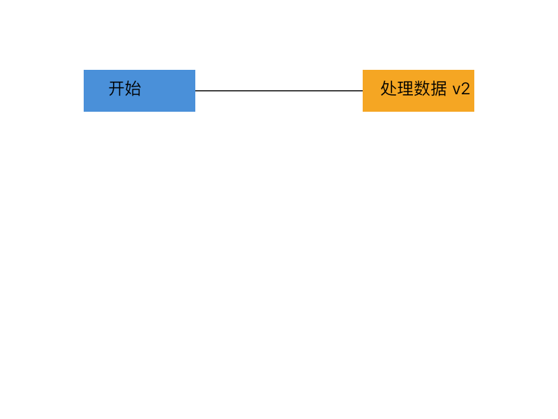

# SVG Editor — Lab1 Phase 1

用 TypeScript 实现的命令行 SVG 编辑器。支持六种图形、嵌套分组、文件读写，以及以一条编辑命令为单位的撤销和重做。

课程要求的架构方案、过程记录、一致性自查和质量保证见 **[doc/README.md](doc/README.md)**。原始任务说明保存在 [doc/assignment.md](doc/assignment.md)。

## 运行

需要 Node.js 22.18 或更新版本。当前工作区已有本地依赖，可以直接运行；首次克隆到其他机器时先执行 `npm ci`。

```sh
npm ci
npm run cli
```

在 `svg>` 提示符后输入：

```text
init 800 600
create g scene
create rect r1 100 100 160 60 #4a90d9 in scene
create text t1 135 135 "开始" in scene
move scene 20 30
undo
tree
save demo.svg
```

用浏览器打开 `demo.svg` 预览，输入 `help` 查看所有命令，按 Ctrl-D 退出。Node 23 可能显示 Type Stripping 的实验性提示，不影响执行。

## 验证与示例

```sh
npm test
npm run cli --silent < examples/flowchart.commands
```

`npm test` 先严格编译再运行全部测试；`npm run check` 是同一验证入口。编译产物也可直接启动：

```sh
npm run build
node dist/cli/Main.js
```

脚本回放生成 [examples/flowchart.svg](examples/flowchart.svg)，包括 8 个图形元素。下面是实际输出的渲染预览：



批量输入省略提示符；遇到错误继续处理后续命令，最终以退出码 1 结束。交互输入逐行显示 `svg>`。

## 实现范围

- 内置 `rect`、`circle`、`ellipse`、`line`、`text`、`g`。
- 共 19 个命令，所有编辑命令支持撤销和重做。
- 支持双引号、空文本、注释行、浮点坐标和自动补 id。
- SVG 读写针对本阶段元素及属性子集；未知元素/属性和不兼容的 viewBox 会明确报错，详见架构文档。
- `box` 和插件加载属于后续阶段，本阶段 `create box` 返回规定的未知类型错误。

## Git 提交

仓库包含真实的分阶段提交，最终本地版本使用 `final` tag。远程地址尚未提供，本地版本尚未推送。

在 GitHub/Gitee 建立空仓库后，将下面的地址替换为自己的仓库地址：

```sh
git remote add origin <仓库地址>
git push -u origin main
git push origin final
```

`final` 须在课程截止时间之前推送；具体截止时间和提交入口以课程通知为准。
