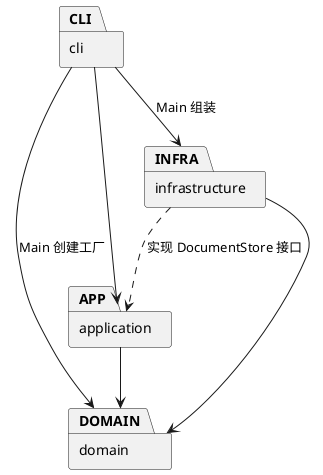

# Lab1 Phase 1：SVG 编辑器

## 架构方案

工程使用 TypeScript 和面向对象设计。编辑命令对文档副本执行，全部成功后再替换当前文档；Command 对象保存执行前后的快照，提供撤销与重做。普通图形和分组实现统一的 Shape 接口。

### 模块划分

| 目录 | 职责 |
| --- | --- |
| `src/domain/` | 图形类层次、几何与属性验证、组合树、文档及层级操作；不执行文件或终端 IO |
| `src/application/` | 命令抽象、具体命令、历史管理、编辑会话、文件存储接口 |
| `src/infrastructure/` | SVG XML 解析与序列化、本地文件读写 |
| `src/cli/` | 参数分词、命令注册与分发、REPL、依赖组装 |
| `test/` | 模型、命令、读写及进程级测试 |
| `examples/` | 可回放的命令序列和外部 SVG 样例 |

### 设计模式的选择

- **Command（必须）**：每个命令一个类，编辑命令继承 EditCommand；历史管理器调用其 undo/redo。一次命令是一个历史单元。
- **Composite**：Group 包含 Shape 子节点，递归实现 move/scale/clone；命令通过统一接口操作叶子和容器。
- **Factory**：ShapeFactory 集中将类型名映射到具体图形类，CLI 创建和 SVG 读取共用工厂。
- **依赖倒置**：应用层依赖 DocumentStore 接口，FileDocumentStore 提供文件系统实现，测试可注入内存实现。

按名字分派只集中在 CommandDispatcher 和 ShapeFactory。两处内置注册表标注为后续插件化阶段的待重构项，本阶段不实现 box 插件。

### 依赖方向规则

domain 不依赖其他工程模块；application 只依赖 domain；infrastructure 依赖 domain 和 application 的存储接口；cli 依赖 application，入口 Main 可依赖 infrastructure/domain 进行组装。模型不知道终端和磁盘，命令不知道具体 XML 库。

### 变化点假设

| 变化点 | 本阶段决定 |
| --- | --- |
| 新增图形或 box 插件 | 保留 Shape 多态接口与单一工厂；动态插件加载留到后续阶段 |
| GUI / agent 输入 | 复用应用命令与模型，CLI 分词和终端 IO 独立 |
| 不同文件存储 | DocumentStore 接口隔离磁盘，可替换内存或远程存储 |
| 更大的画布 / 更长历史 | 先采用快照历史以确保组合编辑完整可逆；大文档再改为增量记录，当前不做过早优化 |
| 更多 SVG 标准特性 | 当前聚焦六种元素及明确支持的属性；读取边界在完成实现后补充 |

## 过程记录

1. 阅读 `phase_cli_1.md`，确认六种内置图形、Command 模式、Composite 语义、IO 后禁止撤销以及分步 Git 提交要求。
2. 初始工作区只有作业说明，没有代码或 Git 仓库；在 `svg-editor/` 新建工程和仓库，先记录架构再实施。
3. 选择在文档副本上执行编辑，以便层级修改或属性验证中途失败时，当前文档与历史都保持原状。

本节后续仅补充实际发生的实现、验证与修订，不虚构人工审查或 AI 讨论。

## 一致性自查

待实现完成后根据实际目录和依赖检查填写。

## 质量保证手段

计划覆盖命令正常路径、错误后状态不变、嵌套组合、撤销重做、SVG 往返和命令脚本回放。最终执行结果在完成后填写。

### 迭代 1：图形模型

- 实现 Shape → GeometryShape → Rect/Circle/Ellipse/Line/TextShape，以及 Group 组合结构；模型不读取文件或输出终端。
- 对未明确规定的跨父容器 group，决定以文档深度优先顺序收集选中元素，放入最近公共祖先下的新组，新组插入首个选中分支的位置。组内顺序不依赖命令参数顺序。
- 第一轮 3 项模型测试通过，覆盖六种类型、深拷贝、嵌套几何变化、顺序、循环防护及属性白名单。
- npm 网络连接失败；从本机现有应用复制已安装依赖到被 Git 忽略的 node_modules，用 TypeScript compiler API 完成严格编译。package.json 和 lockfile 记录版本及公共 registry 地址。此时尚未验证联网全新安装。

### 迭代 2：命令和历史

- 接入 19 个命令类、Tokenizer、命令注册表和逐行 REPL；每次分发创建新的命令对象，防止同一实例覆盖旧历史。
- 编辑命令保存前后文档快照；显示类不入栈；成功 IO 清空两栈并设置屏障，下一次成功编辑解除屏障。
- 27 项测试通过。新增测试逐项验证所有编辑命令的一次撤销/重做、错误不改变 redo 分支、IO 失败不修改路径或历史，以及递归缩放中途溢出的原子性。
- 发现本机应用依赖包裁掉了 Node/XML 类型声明，整工程编译因此报错；采用 `src/Runtime.d.ts` 定义本项目使用的最小平台接口，并关闭自动引入全局类型。声明不含 any，实际边界行为通过 CLI/文件集成测试验证；工程不再依赖 @types/node。

### 迭代 3：读写与验收

- 增加 XML 往返、前向 id 冲突、真实文件失败、进程退出码、源码 CLI 与编译产物 CLI、模块依赖方向和一类一文件测试。
- 第一轮完整测试 53 项中 1 项失败：数字字符引用 `&#10;` 和 `&#x1F916;` 被解析库保留为原字符串。检查库源码后开启数字实体解码，并保留入口的 XML 实体校验；回归测试确认换行、中文、emoji、CDATA 和空白均可往返。
- 对照 `canvas [w] [h]` 修正单个宽度参数：保留当前高度；无参数仅显示，两种修改方式都会阻断历史。
- 当前 56 项测试全部通过，静态编译通过；实际 PTY 中确认 `svg>` 提示符、逐行编辑与 Ctrl-D 退出。
- 回放作业 6.1 节生成 8 个元素的流程图，使用本机 Skia 渲染为 PNG 并检查：两个节点、中文标签和连线显示正确，undo 后右侧节点回到原位。
