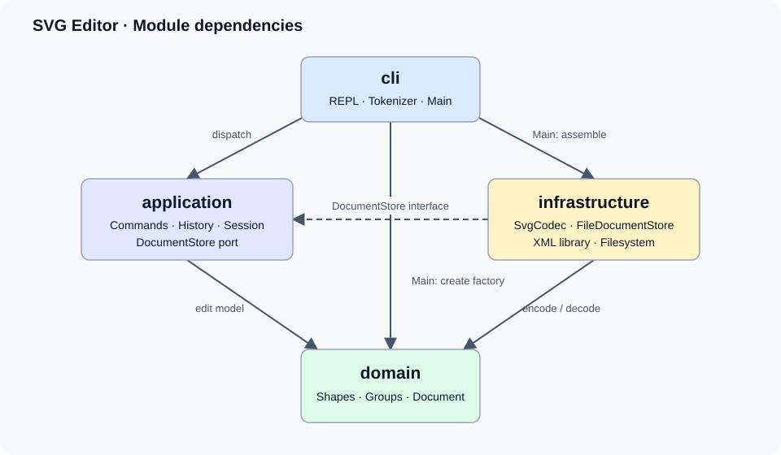
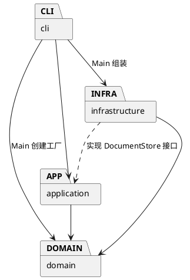

# Lab1 Phase 1：SVG 编辑器

本工程实现 19 个 CLI 命令和六种内置图形，使用 Command 管理编辑历史，使用 Composite 统一操作图形与容器。运行方法见 [工程 README](../README.md)，需求原文见 [assignment.md](assignment.md)。

## 架构方案


工程使用 TypeScript 和面向对象设计。编辑命令对文档副本执行，全部成功后再替换当前文档；Command 对象保存执行前后的快照，提供撤销与重做。普通图形和分组实现统一的 Shape 接口。

### 模块划分

| 目录 | 职责 |
| --- | --- |
| `src/domain/` | 图形类层次、几何与属性验证、组合树、文档及层级操作；不执行文件或终端 IO |
| `src/application/` | 命令抽象、具体命令、历史管理、编辑会话、文件存储接口 |
| `src/infrastructure/` | SVG XML 解析与序列化、本地文件读写 |
| `src/cli/` | 参数分词、命令注册与分发、REPL、依赖组装 |
| `test/` | 模型、命令、读写及进程级测试 |
| `examples/` | 可回放的命令序列和外部 SVG 样例 |



对应的可编辑 PlantUML 源文件为 [architecture.puml](architecture.puml)：



### 设计模式的选择

- **Command（必须）**：每个命令一个类，编辑命令继承 EditCommand；历史管理器调用其 undo/redo。一次命令是一个历史单元。
- **Composite**：Group 包含 Shape 子节点，递归实现 move/scale/clone；命令通过统一接口操作叶子和容器。
- **Factory**：ShapeFactory 集中将类型名映射到具体图形类，CLI 创建和 SVG 读取共用工厂。
- **依赖倒置**：应用层依赖 DocumentStore 接口，FileDocumentStore 提供文件系统实现，测试可注入内存实现。

按名字分派只集中在 CommandDispatcher 和 ShapeFactory。两处内置注册表标注为后续插件化阶段的待重构项，本阶段不实现 box 插件。

### 依赖方向规则

domain 不依赖其他工程模块；application 只依赖 domain；infrastructure 依赖 domain 和 application 的存储接口；cli 依赖 application，入口 Main 可依赖 infrastructure/domain 进行组装。模型不知道终端和磁盘，命令不知道具体 XML 库。

### 变化点假设

| 变化点 | 本阶段决定 |
| --- | --- |
| 新增图形或 box 插件 | 保留 Shape 多态接口与单一工厂；动态插件加载留到后续阶段 |
| GUI / agent 输入 | 复用应用命令与模型，CLI 分词和终端 IO 独立 |
| 不同文件存储 | DocumentStore 接口隔离磁盘，可替换内存或远程存储 |
| 更大的画布 / 更长历史 | 先采用快照历史以确保组合编辑完整可逆；大文档再改为增量记录，当前不做过早优化 |
| 更多 SVG 标准特性 | 当前支持六种元素及属性白名单，未知特性显式报错；完整 SVG/CSS 引擎留到后续需求 |

### 核心执行路径

1. `Main` 组装 ShapeFactory、SvgCodec、FileDocumentStore、EditorSession 与 CommandDispatcher。
2. `Tokenizer` 将一行输入转换为参数，保留引号内空格和空字符串。仅行首（允许前导空白）的 `#` 表示注释，颜色值 `#fff` 保持原样。
3. `CommandDispatcher` 按命令名创建一个新的命令对象，错误统一转换为一行 `error:` 输出。
4. `EditCommand.execute` 复制当前文档，在副本上调用具体命令的 `edit`，全部成功后保存前后快照并提交新文档。
5. `History` 保存命令对象，调用该命令的 `undo` / `redo` 恢复完整树、属性和同级顺序；新编辑清空重做栈。
6. `read` 在解析、id 校验和模型构造全部成功后替换文档；`save` 先写同目录临时文件，再通过 rename 替换目标。

命令对象拥有撤销和重做能力，History 仅管理调用顺序。快照避免为 group、ungroup 和 delete 分别维护复杂的逆操作。历史内存随文档规模和历史长度增长，当前设计适用于课程规模文档。

### 具体语义与范围

| 项目 | 实现决定 |
| --- | --- |
| id | 大小写敏感、全局唯一；不能为空或含空白。读入前先收集全部显式 id，补名时跳过后续已有 id |
| 缺省值 | init 默认 800×600；`init 400` 的高度仍为 600；`canvas 400` 保留当前高度 |
| move / scale | 容器递归到所有子孙；scale 同乘位置与尺寸，不缩放 stroke-width；factor 必须有限且大于 0 |
| set | 公共 fill/stroke/stroke-width 加各类型几何属性；text 通过 `set id text value` 修改子文本；g 的样式采用 SVG 继承语义 |
| group | 支持跨父容器，按文档深度优先顺序收编；新组放在最近公共祖先下、首个选中分支的位置；拒绝同时选择祖先与后代 |
| ungroup | 子节点在原组位置展开，保持顺序；拒绝解散 svg 直接子节点的容器 |
| addto | 移到目标容器末尾；拒绝把容器放入自身或自己的后代 |
| front / back | SVG 后绘制的同级元素在前，因此 front 移到同级数组末尾，back 移到开头 |
| 历史屏障 | 成功 init/read/save/canvas 修改清空历史并阻断 undo/redo；下一次成功编辑解禁；失败操作不修改历史 |
| 显示与帮助 | tree/show/canvas 查询不进入历史；help 可在创建文档前使用 |
| 保存路径 | read 记住路径；成功 `save file.svg` 也更新默认路径；init 清除路径；失败保存不修改路径 |
| 文本与参数 | 双引号包裹带空格内容；支持 `\"` 和 `\\`；支持中文、空文本、XML 实体和 CDATA |
| 批处理 | stdin 脚本无提示符；错误后继续执行，任一命令失败则进程最终退出码为 1 |

SVG 读取支持六种元素、对应几何属性、fill/stroke/stroke-width，以及根节点 xmlns/width/height/viewBox。画布宽高支持数字或 px；缺省宽高为 800×600，缺省图形几何值为 0。文本内容按子文本读写，保存时转义 XML 特殊字符。

viewBox 若存在，必须为 `0 0 width height`。本阶段不导入 transform、CSS style/class、path、tspan、渐变、其他单位或自定义属性；遇到这些内容会报错并保留当前文档。DOCTYPE 和自定义实体不接受。`box` 与插件化按作业阶段边界留到后续。

## 过程记录

2026-11-02，用户要求根据作业说明完成工程。初始目录只有 `phase_cli_1.md`；开发过程中使用 Codex 实现、运行测试并修订。以下记录对应实际开发事件和 Git 提交。

### 迭代 0：需求与方案

- 识别必须项：TypeScript 面向对象、一类一文件、Command、Composite、19 个命令、IO 历史屏障、远程仓库与 final tag。
- 在 `svg-editor/` 初始化 Git，先提交模块职责、依赖规则和变化点假设。
- 选择在文档副本上执行编辑，解决多步分组和递归几何更新中途失败时的状态回滚问题。

### 迭代 1：图形模型

- 实现 Shape → GeometryShape → Rect/Circle/Ellipse/Line/TextShape，以及 Group 组合结构；模型不读取文件或输出终端。
- 对未明确规定的跨父容器 group，决定以文档深度优先顺序收集选中元素，放入最近公共祖先下的新组，新组插入首个选中分支的位置。组内顺序不依赖命令参数顺序。
- 第一轮 3 项模型测试通过，覆盖六种类型、深拷贝、嵌套几何变化、顺序、循环防护及属性白名单。
- npm 网络连接失败；从本机现有应用复制已安装依赖到被 Git 忽略的 node_modules，用 TypeScript compiler API 完成严格编译。package.json 和 lockfile 记录版本及公共 registry 地址。此时尚未验证联网全新安装。

### 迭代 2：命令和历史

- 接入 19 个命令类、Tokenizer、命令注册表和逐行 REPL；每次分发创建新的命令对象，防止同一实例覆盖旧历史。
- 编辑命令保存前后文档快照；显示类不入栈；成功 IO 清空两栈并设置屏障，下一次成功编辑解除屏障。
- 27 项测试通过。新增测试逐项验证所有编辑命令的一次撤销/重做、错误不改变 redo 分支、IO 失败不修改路径或历史，以及递归缩放中途溢出的原子性。
- 发现本机应用依赖包裁掉了 Node/XML 类型声明，整工程编译因此报错；采用 `src/Runtime.d.ts` 定义本项目使用的最小平台接口，并关闭自动引入全局类型。声明不含 any，实际边界行为通过 CLI/文件集成测试验证；工程不再依赖 @types/node。

### 迭代 3：读写与验收

- 增加 XML 往返、前向 id 冲突、真实文件失败、进程退出码、源码 CLI 与编译产物 CLI、模块依赖方向和一类一文件测试。
- 第一轮完整测试 53 项中 1 项失败：数字字符引用 `&#10;` 和 `&#x1F916;` 被解析库保留为原字符串。检查库源码后开启数字实体解码，并保留入口的 XML 实体校验；回归测试确认换行、中文、emoji、CDATA 和空白均可往返。
- 对照 `canvas [w] [h]` 修正单个宽度参数：保留当前高度；无参数仅显示，两种修改方式都会阻断历史。
- 当前 56 项测试全部通过，静态编译通过；实际 PTY 中确认 `svg>` 提示符、逐行编辑与 Ctrl-D 退出。
- 回放作业 6.1 节生成 8 个元素的流程图，使用本机 Skia 渲染为 PNG 并检查：两个节点、中文标签和连线显示正确，undo 后右侧节点回到原位。


### 迭代 4：交付整理

- 将过程记录整理到独立章节，补全实现范围、需求映射、目录与依赖自查、运行和提交步骤。
- 保留任务原文、PlantUML 源文件、可直接查看的架构图、命令脚本、实际 SVG 与 PNG 预览。
- npm 已在离线模式下确认 lockfile 与依赖树一致；联网全新安装仍未验证。
- 此阶段尚未收到远程仓库地址，先完成本地交付和 final 版本标记。

### 迭代 5：连接远程仓库并合并初始化历史

- 用户建立 `Zhangjiajin0522/svg-editor-lab1` 仓库，本地将其配置为 origin。
- 首次推送因远程已有独立初始化提交而被拒绝；用户执行 fetch 后，确认该提交仅包含两行 README。
- 使用 `--allow-unrelated-histories` 合并两条历史，解决 README 的 add/add 冲突，保留完整运行说明并补充真实仓库地址；原有开发提交与远程初始化提交均保留。
- 合并只更新 README 和过程记录，生产源码、依赖和测试文件与已经通过 56 项测试的版本一致。将尚未发布的本地 final 标签更新到合并后的提交。

## 一致性自查

### 模块划分

实际目录与初始方案一致。新增 `scripts/Build.ts` 负责构建，`src/Runtime.d.ts` 声明本工程使用的最小 Node/XML 外部 API；二者属于开发工具与平台类型，不引入模型业务依赖。补充原因已经记入迭代 1、2。

生产源码中的每个类均单独成文件，文件名与类名一致；DocumentStore 是接口。图形字段封装在类内，行为由图形类和组合类实现；没有 switch(tag) 分派。自动检查见 [architecture.test.ts](../test/architecture.test.ts)。

### 依赖方向

| 检查对象 | 实际依赖 | 结论 |
| --- | --- | --- |
| domain | 仅同模块图形、文档和数值验证类 | 符合 |
| application | 同模块命令/历史/接口与 domain | 符合 |
| infrastructure | domain、DocumentStore 类型接口、XML 库及 Node IO | 符合 |
| cli 常规类 | application 与 cli | 符合 |
| Main 入口 | application、domain、infrastructure、Node readline | 符合预设的依赖组装例外 |

自动测试解析全部生产 TypeScript 文件的 import，检查上述方向；也检查一类一文件及 switch 的使用。按名字注册的扩展点只有 CommandDispatcher 与 ShapeFactory，均标注后续插件化重构 TODO。其他待处理架构依赖违规为 0。

## 质量保证手段

### 已执行验证

验证环境为 macOS、Node.js 23.11.0、npm 10.9.2、TypeScript 6.0.3，XML 解析库为 fast-xml-parser 5.10.1。执行 `npm run check`，严格编译通过，56 项自动测试全部通过。完整输出见 [validation.txt](validation.txt)。

| 要求 | 验证证据 |
| --- | --- |
| 六种图形、字段封装、多态和深拷贝 | domain.test.ts；geometry clone 与容器递归操作 |
| 全部编辑命令可撤销重做 | commands.test.ts；比较执行前、撤销后以及执行后、重做后的完整 SVG |
| 新编辑清空 redo，显示不改历史 | commands.test.ts；成功/失败分支分别检查 |
| IO 屏障及失败原子性 | commands.test.ts、svg.test.ts；覆盖 init/read/save/canvas、文件错误和递归溢出 |
| id 唯一与自动补全 | domain.test.ts、svg.test.ts；包含前向重名、大小写不同及整文件重复 id |
| XML 往返与文件输出 | svg.test.ts；实体、CDATA、中文、emoji、空白、继承样式、临时文件清理 |
| CLI 与完整示例 | cli.test.ts；子进程回放 6.1 节，检查 8 个元素、undo 后坐标及文本 |
| 编译产物可运行 | cli.test.ts；直接运行 dist/cli/Main.js |
| 架构约束 | architecture.test.ts；检查 import 方向、单类文件和分派写法 |
| 实际显示 | PTY 验证 svg> 与 Ctrl-D；Skia 渲染检查 [流程图预览](../examples/flowchart-preview.png) |

每次功能阶段完成后提交 Git，修复数字实体解码错误后运行全套回归。最终回归测试全部通过。

### 复现

```sh
npm ci
npm run check
npm run cli --silent < examples/flowchart.commands
node dist/cli/Main.js
```

当前工作区的 node_modules 已可用，可省略安装。联网新安装需要能访问 npm registry；本次环境无法联网安装，实际验证使用本机已安装依赖。Runtime.d.ts 只覆盖本工程使用的外部 API，外部接口正确性由集成测试补充验证。测试验证的是上述 SVG 子集，不覆盖完整 SVG/CSS 规范。
